# British Isles Oldest Buildings

**A searchable atlas of the oldest buildings and historic places of England, Scotland, Wales,
Ireland, the Isle of Man and the Channel Islands**, with maps old and new, the stories told about
them, how to say their names, and walks, rides and drives that link them.

[](LICENSE)
[](DATA_LICENSE.md)
[](requirements.txt)
[](INTERFACE.md)
[](https://github.com/gddickinson/british-isles-oldest-buildings/releases)

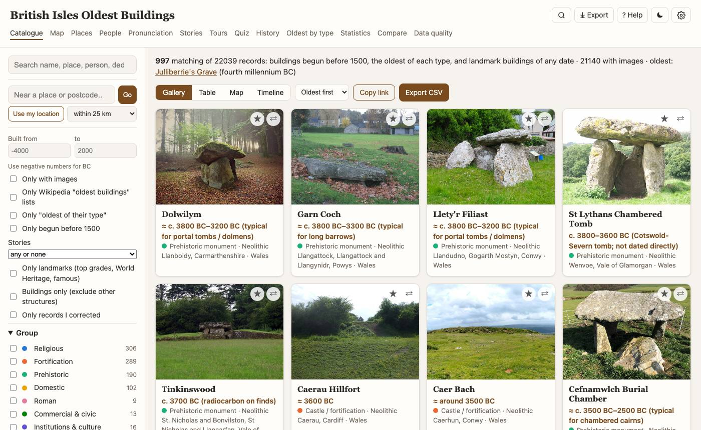

It brings together **Wikidata**, **Wikipedia**, the **official heritage registers** of all five
jurisdictions, **OpenStreetMap** and **historic map collections** into one SQLite database, and
puts a fast local web app on top. Everything runs on your own computer; a static copy can be hosted
anywhere.

| | |
|---|---|
| **22,039** buildings and structures begun before 1500, the oldest of each type, and landmarks of any date | **158,048** places of interest: archaeology, battles, lost places, gardens and trees, finds, plaques, maritime, industrial and Victorian sites, legends and literature, underground works, military heritage, museums and their collections, bridges, excavations and hoards, graves and burial grounds, markets and trade, infrastructure, nature and deep time, and sport |
| **11,927** people connected with them, by **14,766** links | **96 %** of buildings and **52,000** places with a photo |
| **17,412** dated buildings, each date with its source and evidence | **10,506** building outlines and **265** floor plans |
| **790** researched claims with **1,453** quotes checked in their sources | **1,129** tree-ring dates on **592** buildings |
| **2,443** stories, legends and ghost tales | **368** ready-made walks, rides, drives and long-distance ways |
| **7,734** pronunciations (2,145 recordings) in English and the languages of the isles | **45,875** timeline events, **17,649** "on this day" entries |

## Contents
- [Features](#features)
- [Getting started](#getting-started)
- [Keeping the data up to date](#keeping-the-data-up-to-date)
- [How it works](#how-it-works)
- [Testing](#testing)
- [Data sources and licences](#data-sources-and-licences)
- [Research and evidence](#research-and-evidence)
- [Caveats](#caveats)
- [Contributing, citing and licence](#contributing-citing-and-licence)

## Features

### The catalogue and building pages
- **Search** by name, town, saint or person ("Wren" finds his churches). Name matches come first.
- **Filters with live counts:** building group, 31 categories, period, nation, county, heritage
  grade, date basis, date check, status, stories, and a year range (negative years are BC).
- **Near a place:** a town, a postcode or your own location, within a radius.
- **Four views:** gallery, table, map (coloured by group or period) and timeline. Every filter is
  in the address, so **Copy link** shares exactly what you see.
- **A building's page** has the full record; the date with the sentence it came from and a check
  against independent sources; a map with the outline and floor plan; historic maps of the spot;
  stories and a timeline; the people connected with it; nearby buildings and places; more photos;
  how to get there; and links to the official registers. **🗺 Show on the map** opens the Map page
  zoomed in on it.

<table>
<tr><td width="50%">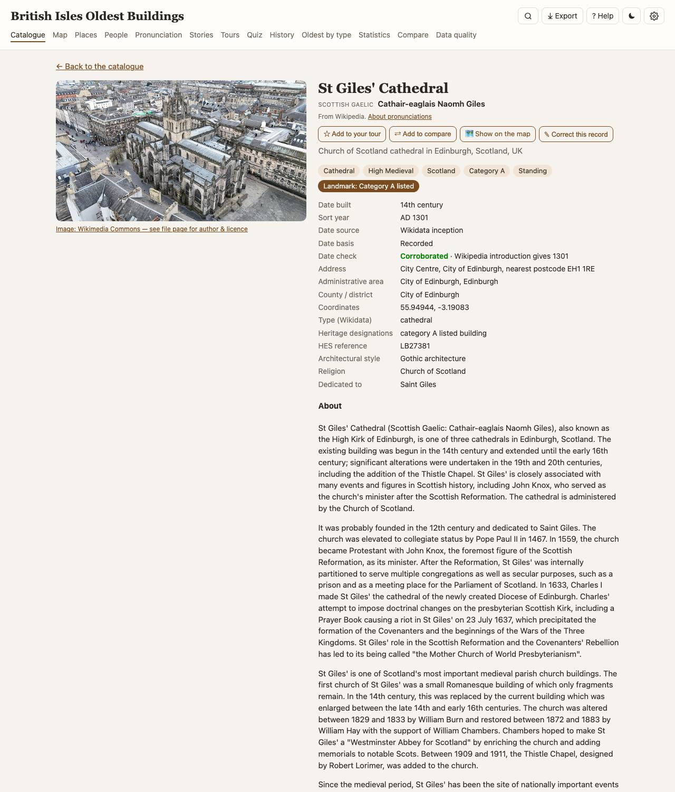<br><sub>A building's page: date with its basis and check, pronunciation, description</sub></td>
<td width="50%">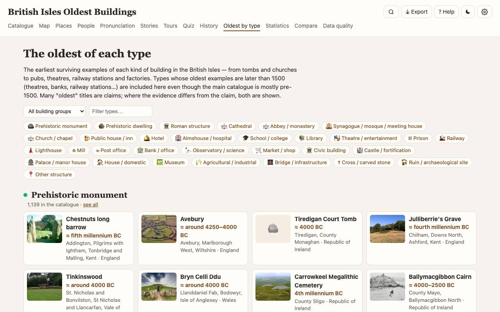<br><sub>The oldest surviving example of each building type, claim against evidence</sub></td></tr>
<tr><td colspan="2">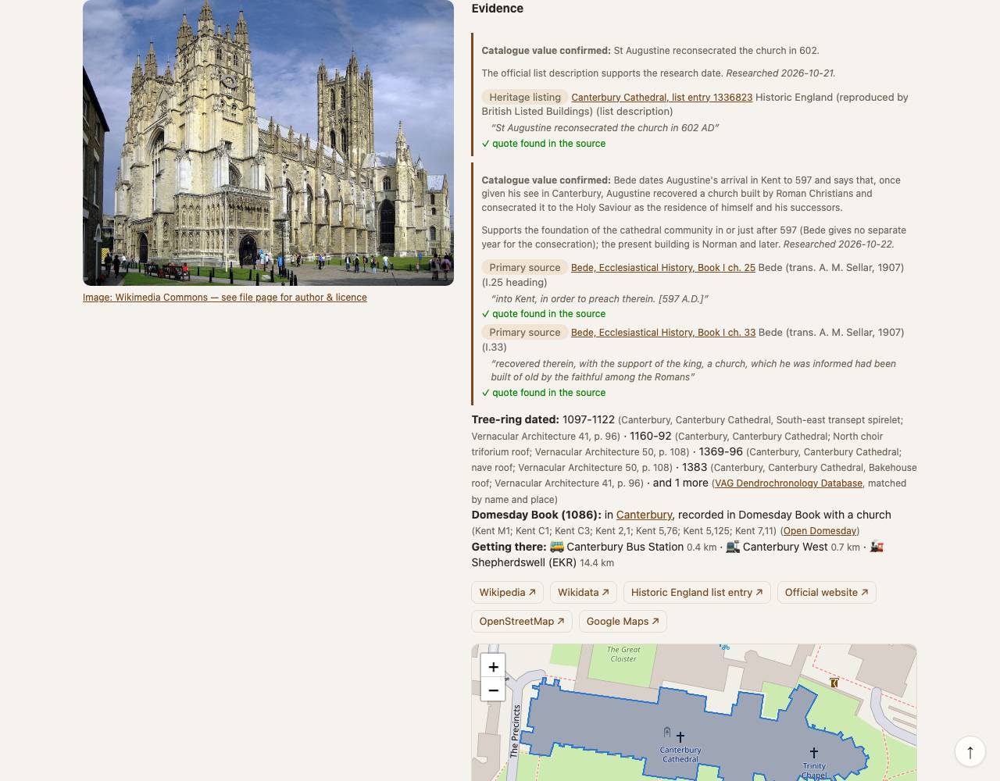<br><sub>Evidence on Canterbury Cathedral: Bede and the list entry with their quotes checked, the tree-ring dates of its roofs, and its Domesday Book entry</sub></td></tr>
</table>

### Maps
- **Three backgrounds:** the online street map, **satellite** imagery (Esri World Imagery with
  place names), or a bundled **offline map** that needs no internet.
- **21 layers:** counties and **historic counties (before 1974)**, national parks, rivers, lakes,
  roads and minor roads, streams, railways and stations, national trails, **walking routes**, the
  **National Cycle Network**, **Roman roads**, **buried rivers**, **underground railways and
  tunnels** (the tube lines, railway, canal and road tunnels), **pillboxes, bunkers and trenches**,
  towns, hills and coast, airports. Borders, parks, routes, Roman roads, buried rivers, tunnels,
  defences and stations also draw over the street map and satellite.
- **17 historic maps** laid over the top with an opacity slider: Ordnance Survey six-inch and
  one-inch, the OS Old Series, the Roy Military Survey (1747–55), Bartholomew, William Smith's
  geological map (1815), the Gough Map (c. 1360), atlases of Roman and Anglo-Saxon Britain, the
  Ordnance Survey of Ireland (all 32 counties, two editions), the Isle of Man and Channel Islands,
  and 153 town plans. If a map's server is down, the bundled copy is shown instead.
- **Historic maps of this place:** each building lists the 4,436 georeferenced maps on Allmaps that
  cover it.
- **Save this area for offline** keeps the full street map of an area for use without internet.

<table>
<tr><td width="50%">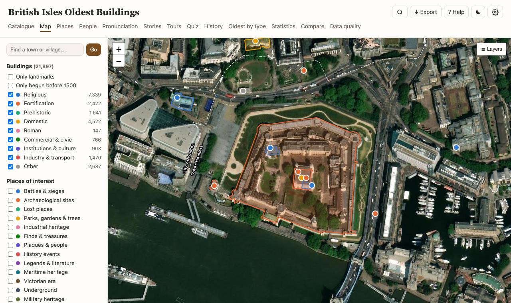<br><sub>Satellite view: the Tower of London with building outlines and catalogue markers</sub></td>
<td width="50%">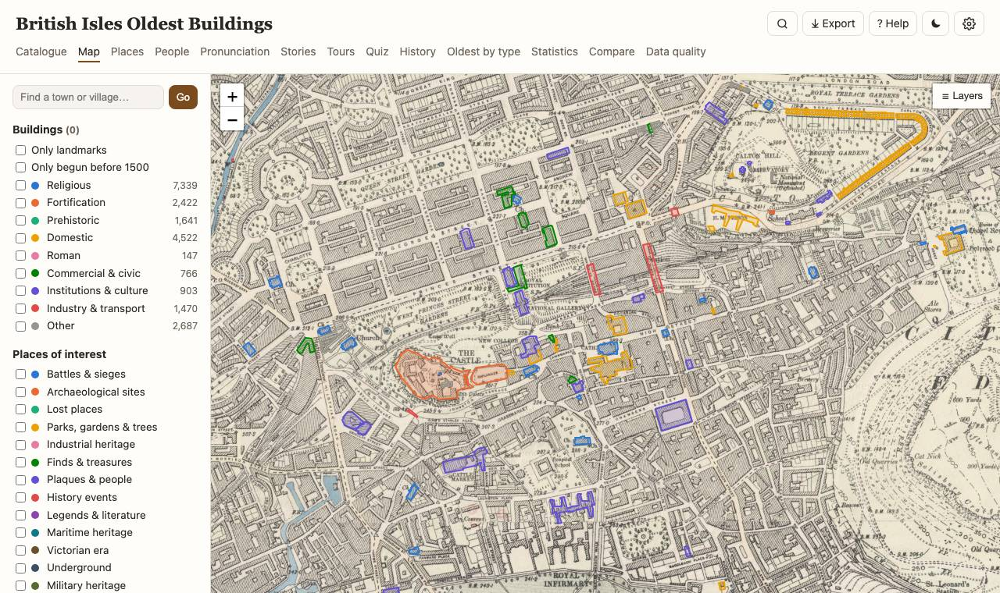<br><sub>Ordnance Survey six-inch map (c. 1900) of Edinburgh's Old Town, with building outlines</sub></td></tr>
<tr><td colspan="2">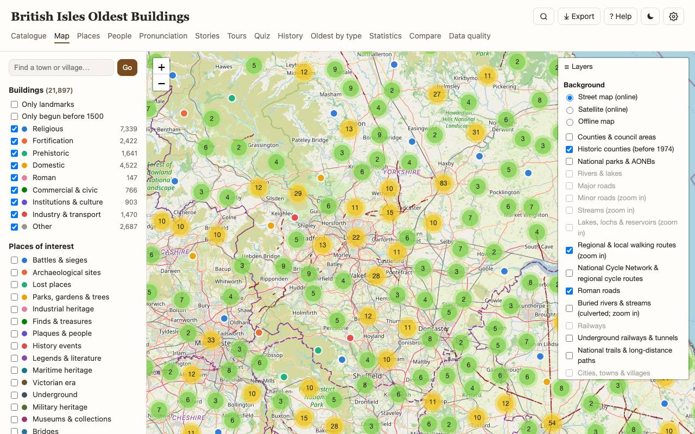<br><sub>The Map page with the layer switcher: Roman roads, walking routes and historic counties over the street map in Yorkshire</sub></td></tr>
</table>

### Places, people and history
- **Places of interest** in twenty-one groups, as a list or a map: battles and sieges; archaeological
  sites (every register's scheduled monuments); lost places; parks, gardens and trees; industrial
  heritage; finds and treasures; plaques (Wikidata and Open Plaques); history events; **legends and
  literature** (haunted places, Arthurian sites, holy wells, the settings of novels and poems);
  **maritime heritage** (harbours, docks, lighthouses, lifeboat stations, shipyards, museum ships);
  the **Victorian era**; **underground** works (tube and metro stations, closed "ghost" stations such
  as Aldwych, tunnels, air-raid shelters and Cold War bunkers, caves and mines, ice houses, grottoes,
  catacombs, Bazalgette's sewers); **military heritage** (the Saxon burhs of the Burghal Hidage,
  Henry VIII's Device Forts, Martello towers, Palmerston forts, batteries, barracks, pillboxes, radar
  stations and sound mirrors, airfields, prisoner-of-war camps, war memorials); and **museums and
  collections** (museums of every kind, art galleries, libraries and archives, with the Mapping Museums
  database's subject, governance, accreditation and opening and closing years, closed museums
  included); and **bridges** (clapper and packhorse bridges, aqueducts, viaducts, swing and suspension
  bridges, footbridges and road bridges); and **excavations** (excavated sites and every *Time Team*
  dig, with what the team looked for); **graves and burial grounds** (cemeteries, churchyards, war
  cemeteries, chest tombs, mausolea and graves); **markets and trade** (market halls and crosses, corn
  exchanges, shops, banks, inns, market towns); more **industrial heritage** (mills, factories,
  manufacturers, breweries, works and quarries of any date); **infrastructure and utilities** (Roman roads,
  milestones, reservoirs, dams, weirs, sea walls, canals and locks, railway lines, signal boxes, power
  stations, airports); and **nature and deep time** (ancient trees, the oldest rocks, fossil sites, the
  earliest human traces, natural wonders); and **sport and leisure** (5,500 football, rugby, cricket, golf and
  Gaelic games grounds and clubs, racecourses and circuits, stadiums, swimming baths and lidos, rowing and yacht
  clubs).
- **The oldest of everything else:** researched lists, each entry with its sources and a verdict on the
  claim, of the oldest trees and natural things, burials, gravestones, churchyards and cemeteries, markets,
  fairs, shops, firms and works, roads, waterworks, railways, canals, docks and communications, and sporting
  clubs and grounds (the Fortingall Yew's contested age, Aveline's Hole, the Latinus stone, Borough Market first
  recorded in 1276, the Post Track of 3838 BC, Sheffield FC, Chester's Roodee, the real tennis court at Falkland
  Palace), on the Oldest page.
- **Tree-ring dates:** buildings dated by dendrochronology (the Vernacular Architecture Group's database)
  show when their timbers were felled.
- **Digs and treasure:** excavated buildings and places say when and by whom (Verulamium: the
  Wheelers, Frere); **Finds & treasures** includes the hoards in Wikipedia's lists, with find-spot,
  year found, contents and the museum that keeps them.
- **Domesday Book:** buildings and places in a settlement recorded in Domesday Book (1086) say so, and for
  churches, abbeys and cathedrals what the entry records there ("with 2 churches and a priest", from Open
  Domesday, with the Phillimore reference).
- **Then:** paintings, prints and drawings of a building or place made before 1950 (Turner's
  Caerlaverock, Billings' drawings), from Wikidata and Wikimedia Commons.
- **Kept here:** a museum's page lists its best-known objects (the Rosetta Stone and the Lewis
  chessmen at the British Museum, *Mallard* at the National Railway Museum), and finds and hoards link
  to the museum that holds them.
- **People** with short biographies, every building and place they are linked to, and the source of
  each link.
- **History:** a short history of the British Isles with sourced events on a map, and **on this
  day** for any date (dates before 1752 in the calendar of the time, so Hastings is 14 October).
- **Statistics:** charts by nation, period, category and designation, data completeness, and the
  oldest building in each county.
- **Quizzes:** ten of them, easy or hard, new questions every round: guess the period, which is older, oldest
  of four, put them in order, which county, say the name (Woodnesborough is "WINZ-brə"), whose ghost story,
  when did it happen, how old is it (trees, graves, markets, sporting clubs), and a mixed bag. Best scores are
  kept in your browser.

<table>
<tr><td width="50%">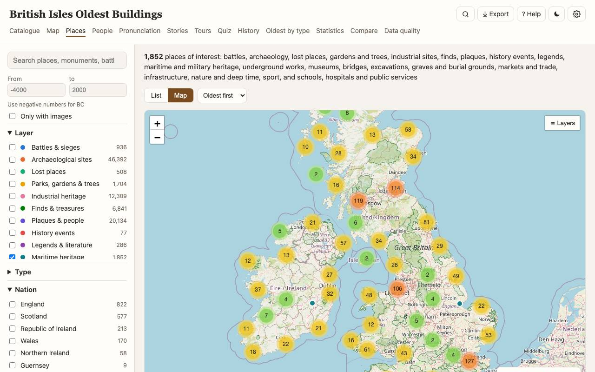<br><sub>Places of interest: maritime heritage on the map</sub></td>
<td width="50%">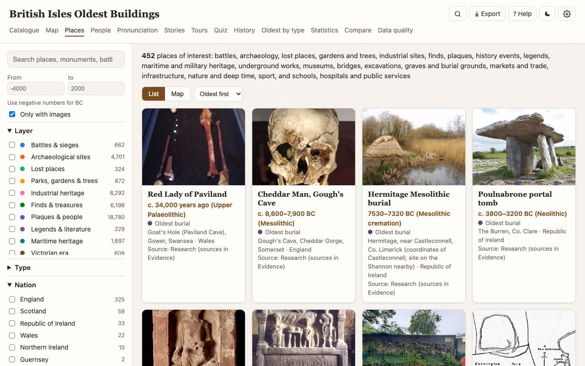<br><sub>Graves and burial grounds, oldest first: the Red Lady of Paviland, Cheddar Man, Poulnabrone</sub></td></tr>
<tr><td width="50%">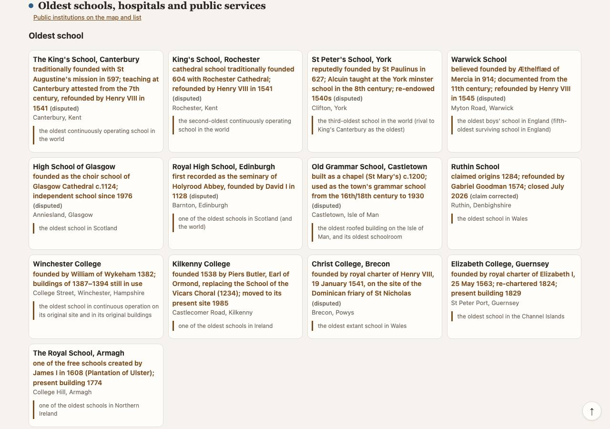<br><sub>The oldest of everything else: researched lists with dates, places and claims</sub></td>
<td width="50%">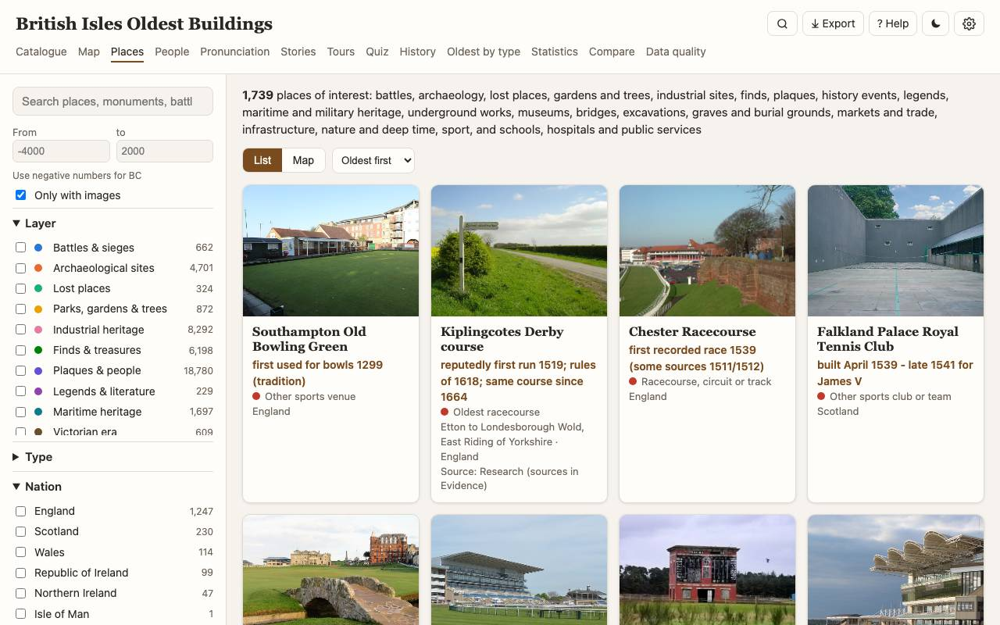<br><sub>Sport and leisure, oldest first: Southampton's bowling green, the Old Course at St Andrews, the Royal Cork Yacht Club</sub></td></tr>
<tr><td width="50%">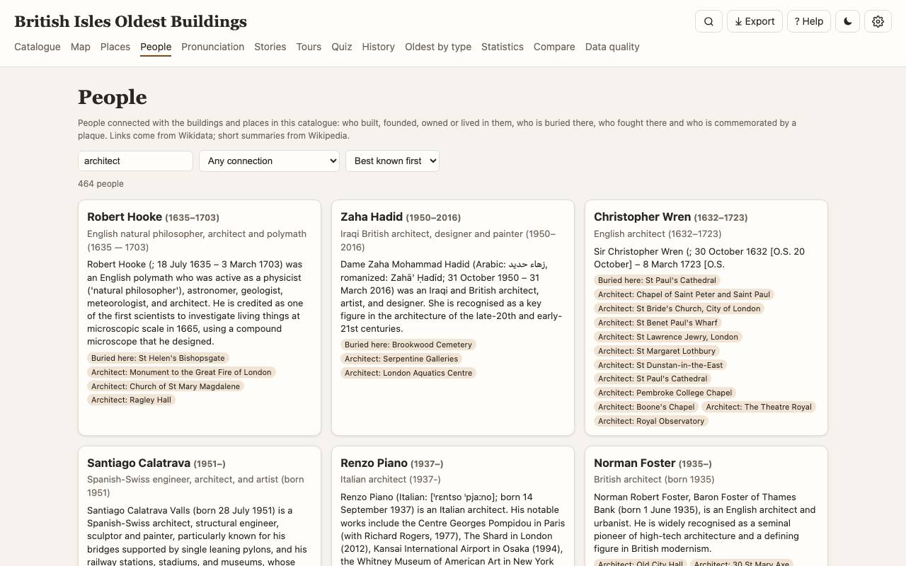<br><sub>People connected with the buildings: architects</sub></td>
<td width="50%">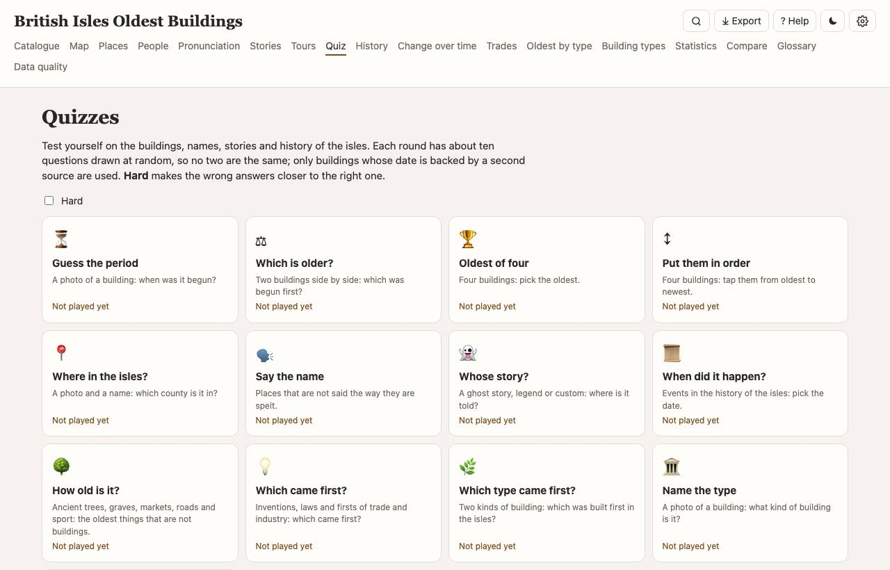<br><sub>Ten quizzes, easy or hard</sub></td></tr>
<tr><td width="50%">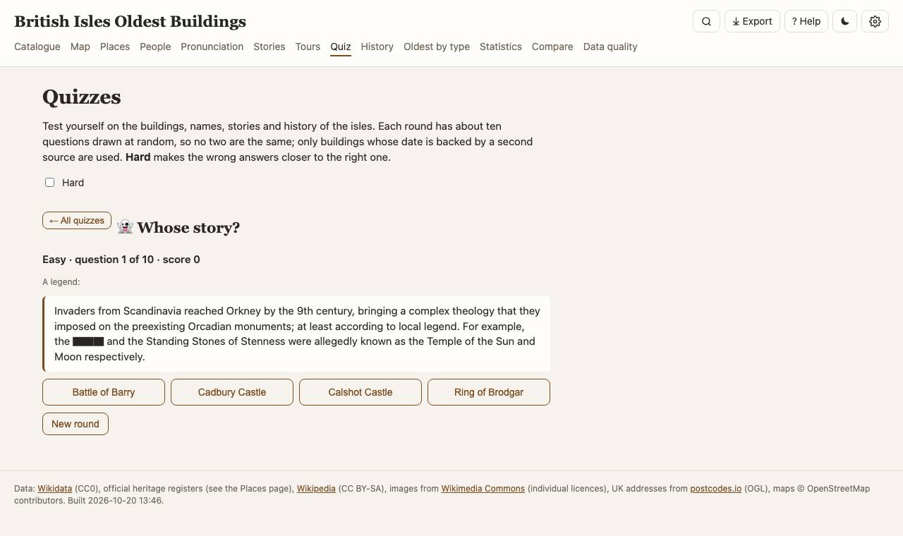<br><sub>Whose story? A legend with the place's name hidden</sub></td>
<td width="50%">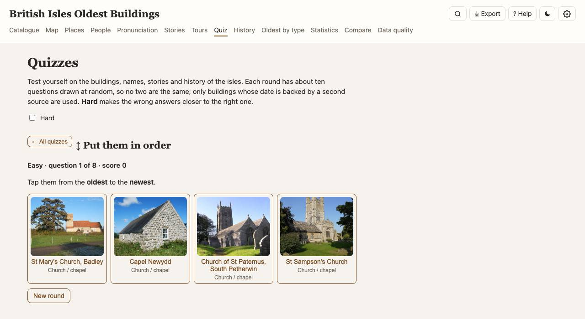<br><sub>Put them in order: tap four buildings from oldest to newest</sub></td></tr>
<tr><td width="50%">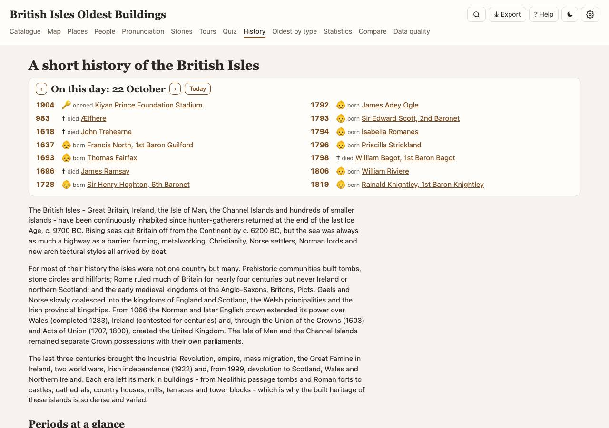<br><sub>History of the British Isles and on this day</sub></td>
<td width="50%">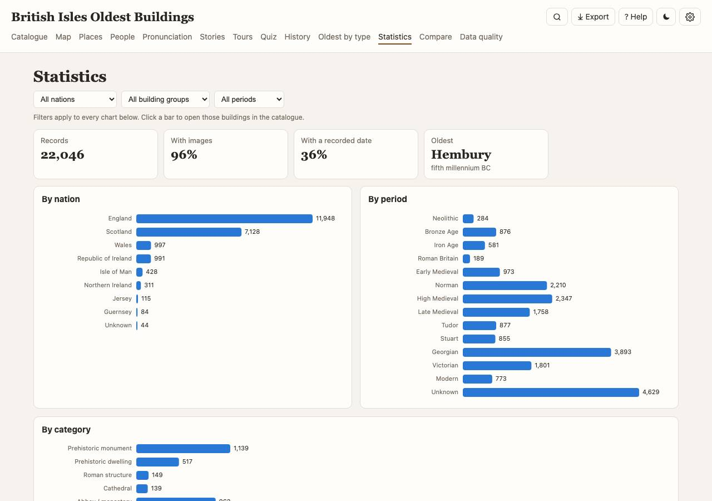<br><sub>Statistics</sub></td></tr>
</table>

### Stories and tours
- **Stories:** the Grey Lady of Stirling Castle, the giant Cormoran of St Michael's Mount, the
  witches of the Rollright Stones, priest holes and smugglers' tunnels. They come from each record's
  Wikipedia article, in four themes (ghosts, legends, folklore, curious history), with a map and
  **read aloud**.
- **368 ready-made tours:** walks around historic towns, bike rides and drives, by theme (ghosts and
  legends, prehistoric, castles, churches, Roman, literary, maritime, industrial, Victorian,
  underground, coastal defences, military heritage, museums and galleries, bridges, archaeology and digs), plus
  **89 long-distance and pilgrim ways** in day stages. Routes follow real paths and roads, with
  distance, time, an **elevation profile** and how hilly it is.
- **Your tour:** star (☆) anything to add it, or let the planner **suggest a tour** from a starting
  point. Choose walking, cycling or driving, find the **best order**, add **stops along the way**,
  save, share, download GPX or KML, open in Google Maps, or **follow** it with your location.

<table>
<tr><td width="50%">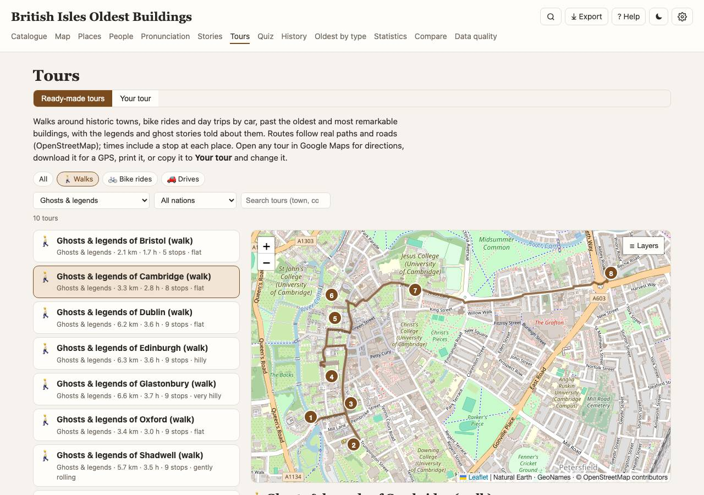<br><sub>A ghosts and legends walk in Cambridge along real streets</sub></td>
<td width="50%">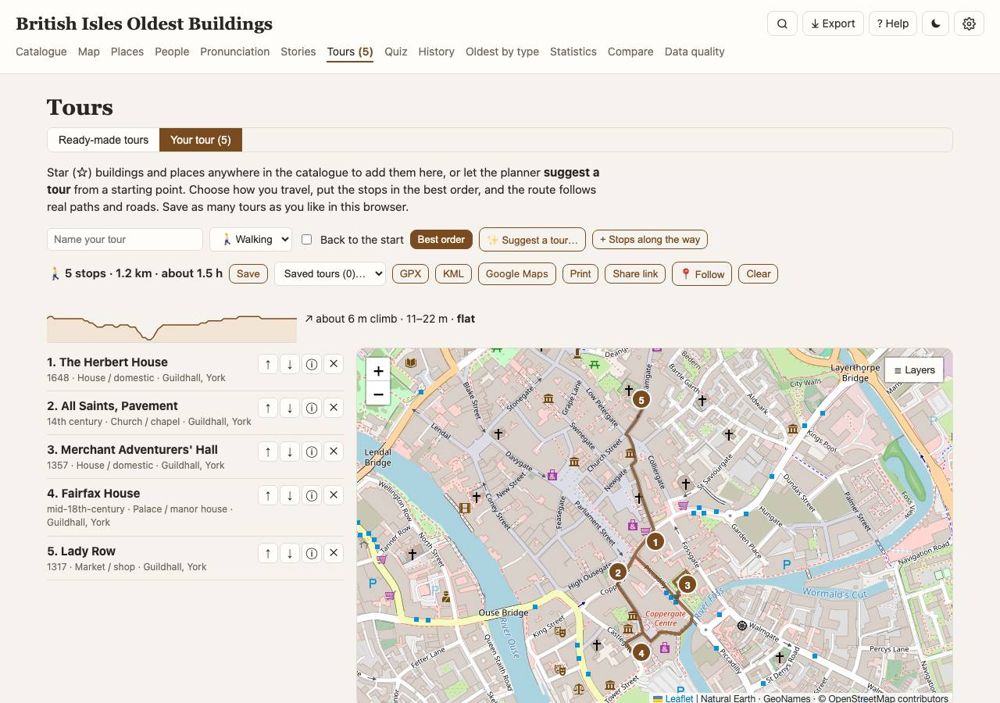<br><sub>Your tour: five stops in York, in the best order, with an elevation profile</sub></td></tr>
<tr><td colspan="2">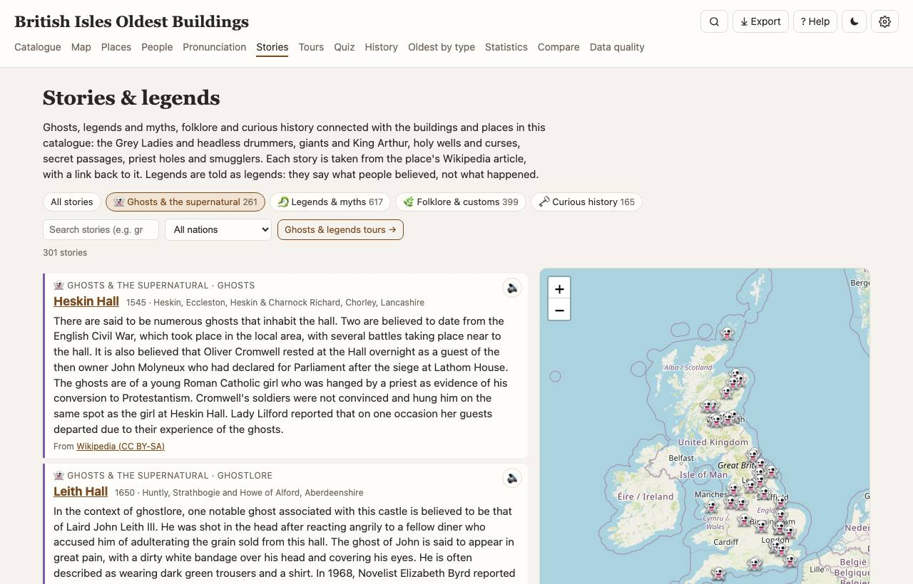<br><sub>Stories: ghosts and the supernatural, with a map</sub></td></tr>
</table>

### How to say the names
Under each name is how to say it: the variety, IPA, a respelling with the stress in capitals and ▶
a recording. Belvoir is "BEE-vər", Cholmondeley "CHUM-lee" and Kirkcaldy "kur-KAW-dee". Names in
Welsh, Scottish Gaelic, Irish, Manx, Scots, Cornish and Jèrriais come with them, and a "Saying …"
line covers the town the record is in.

<table>
<tr><td width="50%">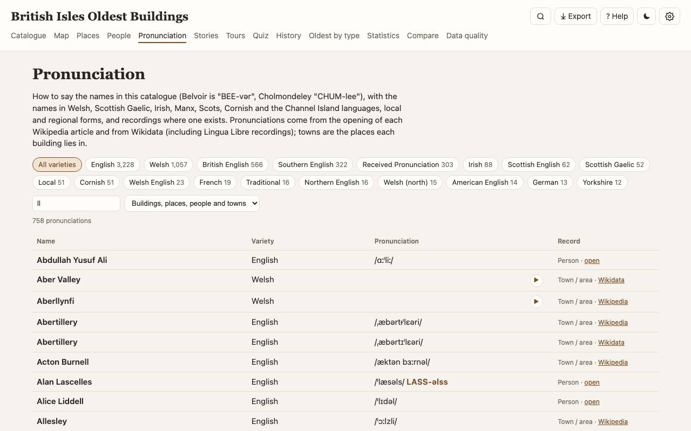<br><sub>The pronunciation guide, by variety</sub></td>
<td width="50%">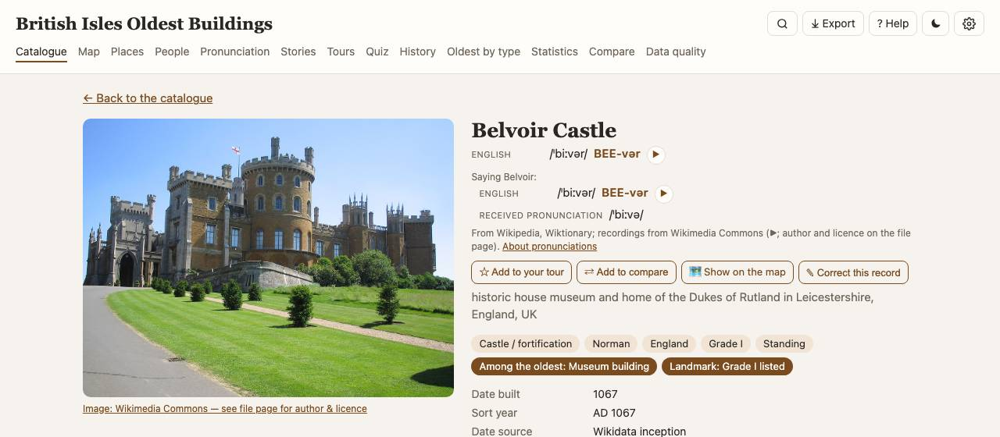<br><sub>A pronunciation under a building's name</sub></td></tr>
</table>

### A comfortable app
- **Quick search** (<kbd>⌘K</kbd> / <kbd>Ctrl+K</kbd>) to any page, building, place or person, and
  keyboard shortcuts (<kbd>?</kbd> lists them).
- **Export** what you see: CSV, JSON, GeoJSON or KML, a screenshot, print or PDF, or a link.
- **Settings:** light and dark themes, text size, density, km or miles, default map, backup and
  restore of everything you saved, and where the data lives.
- **Works on a phone**, can be **installed** from the browser, and keeps pages you've opened for
  offline use.
- **Share at home:** other computers, tablets and phones on your network can browse the app (read-only),
  from an address or QR code in Settings.
- **Help:** a full guide with screenshots, a glossary and answers to common questions.

<table>
<tr><td width="34%">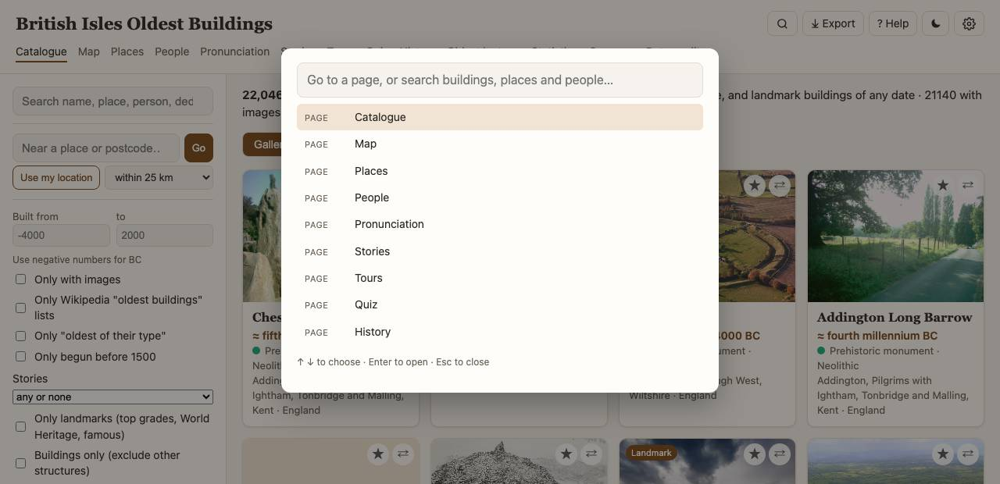<br><sub>Quick search (⌘K)</sub></td>
<td width="34%">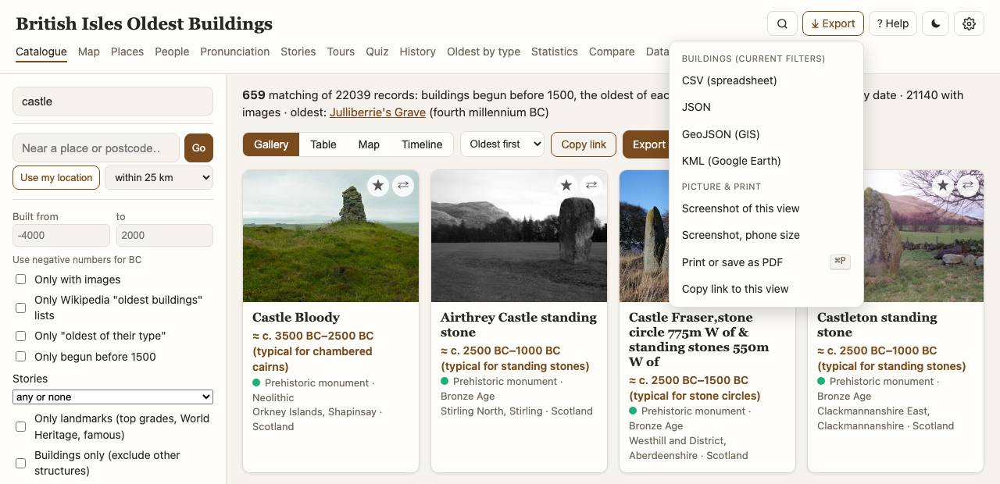<br><sub>The Export menu</sub></td>
<td width="32%">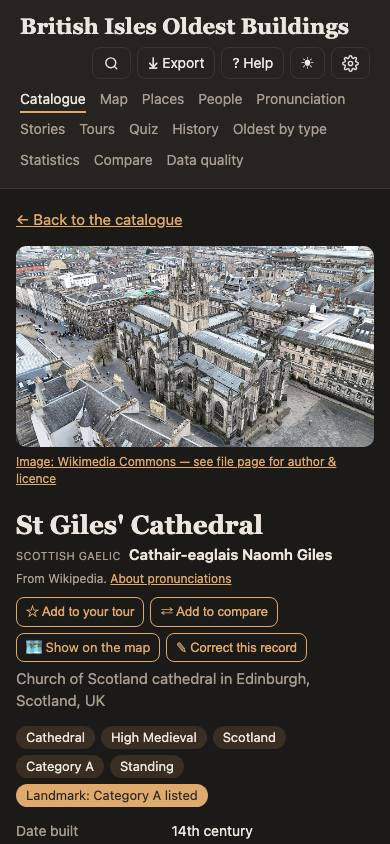<br><sub>Dark theme at phone width</sub></td></tr>
</table>

## Getting started

### Requirements
- **Python 3.11** (other recent versions should work) and a shell (macOS or Linux; on Windows use
  WSL, or run the Python commands below directly).
- A modern browser. Optional: **Google Chrome** for screenshots and the browser tests, **Node.js 22+**
  for the browser tests, the **GitHub CLI** (`gh`) to publish database releases.
- About 300 MB of disk for the app and database; another ~3 GB if you build the data yourself.

### Install and run
```sh
git clone https://github.com/gddickinson/british-isles-oldest-buildings.git
cd british-isles-oldest-buildings
./run.sh            # creates .venv, installs Flask, requests and pmtiles, starts the app
```
Open **http://127.0.0.1:5050**. The first time, the app opens on a **setup page** with three
choices:

1. **Use the bundled database** (recommended): downloads the latest
   [database release](https://github.com/gddickinson/british-isles-oldest-buildings/releases)
   (57 MB), checks it against `data/bundled.json` and unpacks it. Ready in a minute or two.
2. **Use data you already have:** point it at a folder or drive holding the database and/or the
   download cache from another computer.
3. **Build from scratch:** downloads everything from the sources (several hours; about 3 GB of
   cached responses, which an external drive suits). It runs in the background with a progress bar
   and keeps going if you close the app.

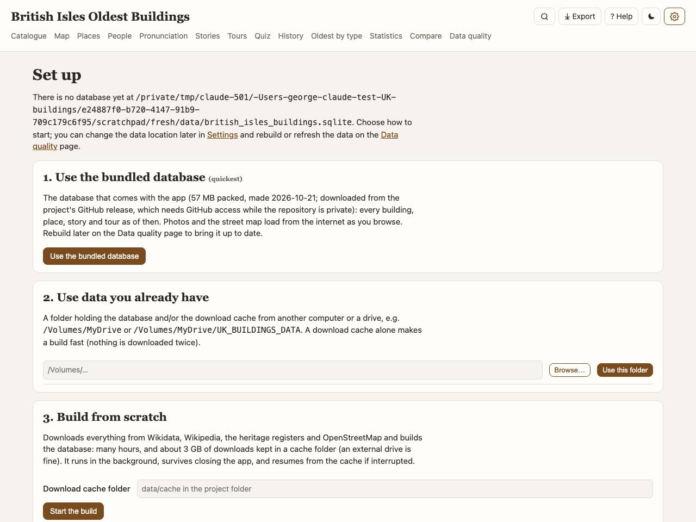

The same choices from the terminal:

| Command | What it does |
|---|---|
| `./run.sh --bundled` | download and unpack the bundled database, then start |
| `./run.sh --data /Volumes/MyDrive` | use the data on that drive (or start a download cache there) |
| `./run.sh --build` | build the database in the terminal, then start |
| `./run.sh --port 5060` | use another port |
| `./run.sh --lan` | share on the home network for this run (other devices can browse, not change anything) |

Without `run.sh`:
```sh
python3 -m venv .venv && .venv/bin/pip install -r requirements.txt
.venv/bin/python -m bidb.setup unpack          # download and unpack the bundled database
.venv/bin/python -m app.server --port 5050
```

**Sharing at home:** Settings → *Share on my home network* (or `./run.sh --lan`) makes the app reachable
from other computers, tablets and phones on the same network, at the address Settings shows (with a QR
code). Other devices are read-only: builds and jobs, corrections, saved street maps, the data location and
the settings stay with the computer running the app (enforced by the server, `app/lan.py`).

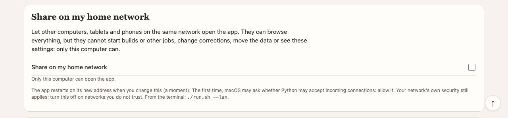

**Where the data lives** is set in Settings → Data location (saved in `settings.json`, not in git).
The cache and the database can each be moved to another drive. A move copies, verifies, switches
over and only then deletes the old copy. If a configured drive is unplugged, the app and the build
stop with a message instead of starting again on the internal drive.

## Keeping the data up to date
The **Data quality** page lists gaps and date conflicts and runs the long jobs: rebuild, photos,
outlines and floor plans, offline map layers, the hosted copy, and packaging the database. Each shows
its stage, items done, downloads vs cache hits and the time left. Jobs run in the background, keep
going if you close the app, and are picked up again when you come back.

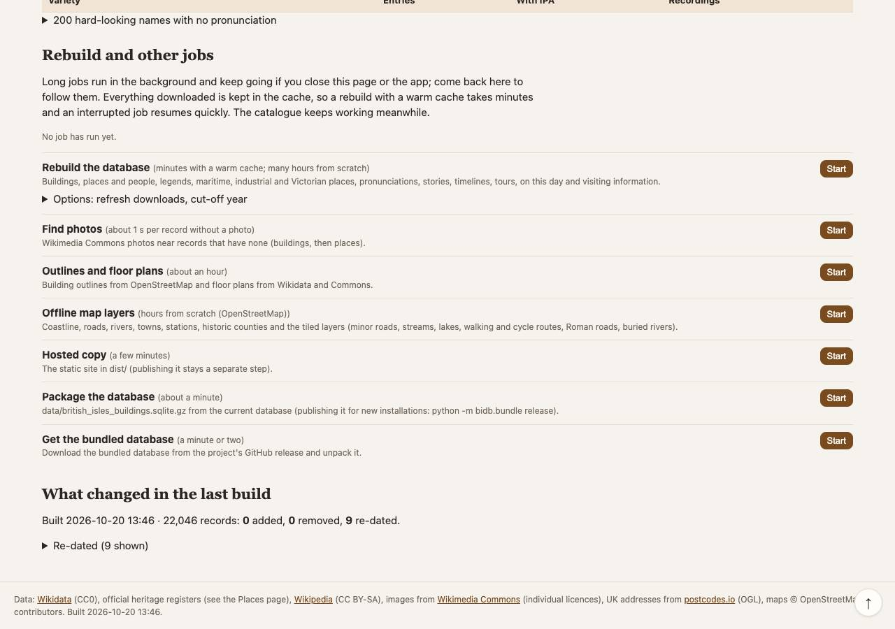

Every download is cached, so a rebuild reuses them. To pick up newer edits, refresh what is older
than some days, or everything from chosen sources:

| Task | Command |
|---|---|
| Rebuild from the cache | `.venv/bin/python -m bidb.build` |
| Refresh downloads older than 30 days | `.venv/bin/python -m bidb.build --refresh-days 30` |
| Refresh one or more sources | `.venv/bin/python -m bidb.build --refresh wikidata,wikipedia` |
| Include buildings begun before another year | `.venv/bin/python -m bidb.build --cutoff 1300` |
| Photos, outlines and floor plans | `.venv/bin/python -m bidb.images_extra buildings` · `… places` · `.venv/bin/python -m bidb.footprints` |
| Offline map layers | `.venv/bin/python -m app.basemap_build` · `.venv/bin/python -m app.basemap_tiled` |
| Static copy for any web host | `.venv/bin/python -m app.static_export` → `dist/` |
| Publish a new bundled database | `.venv/bin/python -m bidb.bundle release` (then commit `data/bundled.json`) |
| Where everything is | `.venv/bin/python -m bidb.setup status` |

Refresh sources: `wikidata`, `wikipedia`, `commons`, `registers`, `osm`, `postcodes`, `maps`.

## How it works
```
Wikidata · Wikipedia · heritage registers · Open Plaques · OpenStreetMap · postcodes.io
        │  bidb/  (polite, cached downloads → records → dates, checks, people, stories, tours)
        ▼
data/british_isles_buildings.sqlite   (buildings, places, persons, stories, tours, timeline, … + FTS5)
        │  app/   (Flask: JSON API + pages)            app/static_export.py
        ▼                                                     ▼
local web app on http://127.0.0.1:5050               dist/: static copy, API answered in the browser
```
- **`bidb/`** builds the database: one module per concern (Wikidata queries, Wikipedia parsing,
  registers, dates and date checks, places, people, pronunciations, stories, tours, elevation,
  nations). `python -m bidb.build` runs every stage.
- **`app/`** is the Flask app: blueprints for the API, pages, jobs and settings; JavaScript per page
  in `app/static/`; offline map data in `app/static/data/`.
- **`INTERFACE.md`** maps every file, its purpose and how they connect. Start there.
- **`ROADMAP.md`** has what's done and what's planned; **`SESSION_LOG.md`** the history of the work.

## Testing
```sh
.venv/bin/python -m unittest discover tests                         # 108 unit tests
node tests/ui_prefs_test.js                                          # preference logic
.venv/bin/python -m tests.ui_check --base http://127.0.0.1:5050      # every page loads without errors
node tests/ui_review.mjs --base http://127.0.0.1:5050                # full GUI review
node tests/ui_review.mjs --base http://127.0.0.1:8099 --static       # the same for dist/ (python -m http.server 8099 -d dist)
```
The **GUI review** drives Chrome through every page and map. It checks every map layer, historic
map and places layer, the satellite and offline backgrounds, pop-ups, search ranking, the tour
builder and other interactions, and phone widths. It records JavaScript errors and failed requests,
and saves a screenshot of each check in `runs/ui_review/`. `node docs/make_figures.mjs` regenerates
the figures in this README and the Help page (app running; `node docs/make_figures.mjs tours oldest` for some).

## Data sources and licences
- **Code:** MIT ([LICENSE](LICENSE)).
- **Data:** each source keeps its own licence; [DATA_LICENSE.md](DATA_LICENSE.md) lists them with
  the credits to keep:
  - Wikidata and Open Plaques: CC0;
  - Mapping Museums (Birkbeck): CC BY 4.0;
  - Wikipedia text: CC BY-SA 4.0 (share-alike);
  - OpenStreetMap data: ODbL (share-alike);
  - Historic England, Historic Environment Scotland, Cadw and Northern Ireland's Historic
    Environment Division: Open Government Licence;
  - Ireland's National Monuments Service and NIAH: CC BY 4.0;
  - Open Domesday (Anna Powell-Smith): CC BY-SA 4.0;
  - the Vernacular Architecture Group's Dendrochronology Database (Archaeology Data Service): ADS terms
    of use, free for research, teaching and personal use;
  - GeoNames: CC BY 4.0; Natural Earth: public domain;
  - historic maps from the National Library of Scotland (CC BY), Allmaps and Wikimaps Warper;
  - satellite imagery: © Esri, Maxar, Earthstar Geographics;
  - photos: Wikimedia Commons, each under its own licence and credited on its file page.

The builder uses public services politely: it rate-limits every request, caches every response, and
identifies itself with this repository's address.

## Research and evidence
Claims can be substantiated from original and published sources in `data/curated/evidence.json`: each
claim lists its sources (primary, heritage listing, secondary or reference work), where in each and an
exact short quote. `.venv/bin/python -m bidb.evidence --check` fetches every source again and confirms
that the quote is there. Detail views show the evidence, and the Data quality page lists every claim
with its verdict. The research is done with AI assistance; quotes are checked automatically, but the
judgements are not, so corrections are welcome (see [CONTRIBUTING.md](CONTRIBUTING.md)).

So far (see the research track in [ROADMAP.md](ROADMAP.md)): **790 claims with 1,453 quotes**, each
checked again in its source by script.
- **Every "oldest of its type" example** is checked against its official list description (Historic
  England, Historic Environment Scotland, Cadw, Northern Ireland's register, Ireland's NIAH, Manx
  National Heritage) or another citable source. Where the listing dates the surviving building
  differently from a famous claim, the catalogue gives the listing's date and keeps the claim as a claim:
  Ye Olde Fighting Cocks is a 16th-century building (claimed 793), Sean's Bar c. 1725 (claimed c. 900),
  the Bingley Arms carries a plaque of 1738 (claimed 953).
- **The earliest churches and monasteries** are checked against primary sources: Bede, the Anglo-Saxon
  Chronicle, the Annals of Ulster, Anglo-Saxon charters (Electronic Sawyer, with each charter's standing),
  Asser and the Victoria County History, which sharpen "7th century" to Reculver 669, Wearmouth 674 or
  Rochester 604, and flag dates that rest only on later tradition.
- **The 100 oldest records** are checked against radiocarbon and Bayesian dating (Avebury's henge c. 2900 BC,
  not 4250 BC; Knap of Howar's stone houses c. 3300 BC after the 2025 redating), **manor houses** against the
  Victoria County History (many "Domesday" dates were the manor's, not the house's), and buildings against
  their **tree-ring dates** (The Commandery, Worcester, c. 1465, not "1977").
- **164 reviewed date corrections** (`data/curated/date_corrections.json`), each with its evidence.

## Caveats
- **Dates** are the earliest construction date; many buildings were rebuilt later. Dates not taken
  directly from a source carry a "≈" and say how they were found (mined from text, or estimated from
  the building type). The **date check** compares sources and flags conflicts; 58 reviewed conflicts
  are recorded with reasons in `data/curated/date_confirmations.json`.
- **Researched files** in `data/curated/` (history events, oldest examples of each type, places of
  legend) were compiled with AI assistance from cited sources and checked against them
  (`python -m bidb.verify_research`); disputed claims are flagged.
- **Stories** are what the sources say is told, not claims that the events happened.
- **Underground, military and museum places** come from Wikidata classes, plus short curated lists
  (`data/curated/underground_sites.json`, `burhs.json`). Coverage follows Wikidata: a "closed" museum
  or station is one Wikidata gives a closing date for, and stop lines such as the GHQ Line have no
  location there. Museums that are already catalogue buildings stay in the catalogue.
- **Treasure find-spots:** only hoards whose find-spot is published (Wikipedia's lists, Wikidata) are
  shown. The Portable Antiquities Scheme publishes metal-detected finds only to about 1 km or the
  parish, and its database cannot be read by a script.
- **Opening hours, fees and who looks after a place** come from OpenStreetMap; check before you go.
- **Not included:** Jersey's Historic Environment Record (no open licence), Guernsey's lists (no
  locations) and the Isle of Man register (not machine-readable). Their heritage comes from Wikidata.
- The Channel Islands are included as Crown Dependencies, in the usual political sense of "British
  Isles".

## Contributing, citing and licence
- **Contributing:** corrections and code are welcome; see [CONTRIBUTING.md](CONTRIBUTING.md). The
  best fix for a wrong date or place is usually on Wikidata, linked from every record.
- **Citing:** see [CITATION.cff](CITATION.cff) (GitHub's "Cite this repository").
- **Licence:** code under the [MIT License](LICENSE); data under its sources' licences
  ([DATA_LICENSE.md](DATA_LICENSE.md)).

### Acknowledgements
The Wikidata and Wikipedia communities; Historic England, Historic Environment Scotland, Cadw, the
Department for Communities' Historic Environment Division and Ireland's National Monuments Service and
NIAH for open registers; OpenStreetMap contributors; Open Plaques; the National Library of Scotland,
Allmaps and Wikimaps Warper for historic maps; the Historic County Borders Project; GeoNames and
Natural Earth; FOSSGIS for OSRM routing; OpenTopoData; Protomaps; Leaflet.
