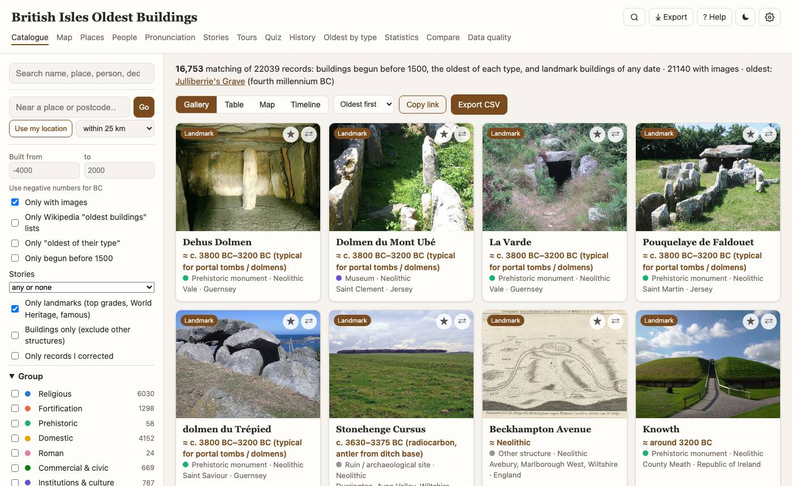
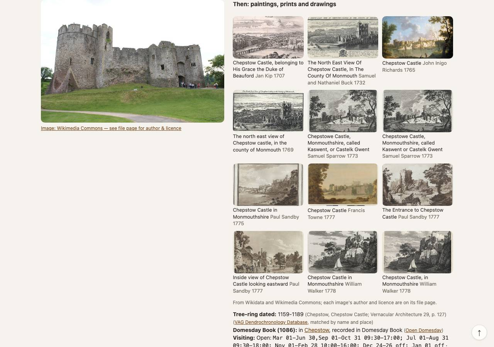
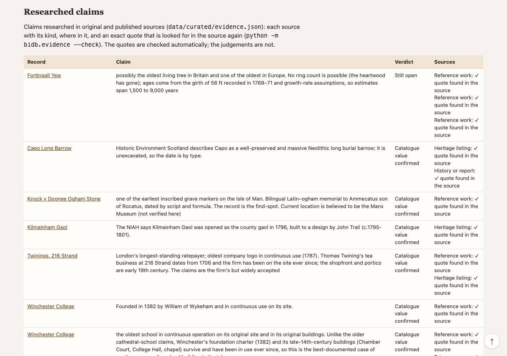
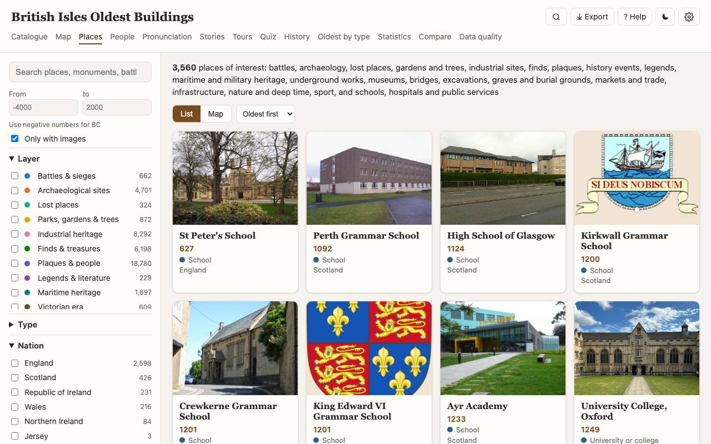
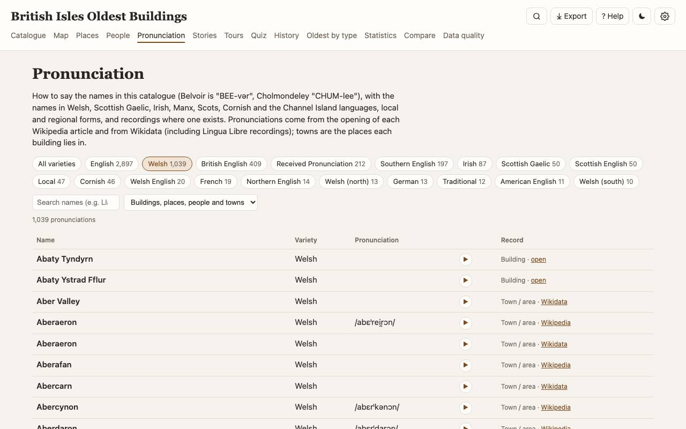

# British Isles Oldest Buildings

**An atlas of the oldest buildings and historic places of England, Scotland, Wales, Ireland, the Isle
of Man and the Channel Islands**: 22,000 buildings and 173,000 places on maps old and new, with the
evidence for their dates, the people and stories connected with them, how to say their names, tours
that link them, and quizzes.

[](LICENSE)
[](DATA_LICENSE.md)
[](requirements.txt)
[](INTERFACE.md)

**[Try the demo site](https://gddickinson.github.io/british-isles-oldest-buildings/)**: the whole catalogue, maps, places, stories, tours and quizzes in the
browser, nothing to install (a static copy: no editing or rebuilding, place descriptions shortened).



The app brings together **Wikidata**, **Wikipedia**, the **official heritage registers** of all five
jurisdictions, **OpenStreetMap**, **historic map collections** and specialist datasets (tree-ring dates,
Domesday Book, museums) in one SQLite database. A fast web app runs on top of it on your own computer, can
be shared read-only on your home network, and exports to a static copy that any web host can serve.

| The catalogue | Around it |
|---|---|
| **22,039** buildings and structures: everything begun before 1500, the oldest of each type, and landmarks of any date | **166,325** places of interest in **22 groups**, from battlefields and hoards to sports grounds, schools and hospitals |
| **17,412** dated buildings, each date with its source, basis and a check against other sources | **870** researched claims with **1,660** quotes, re-checked in their sources by script |
| **11,927** people linked to the buildings and places they built, owned, lived in or are buried in | **96 %** of buildings and **55,000** places with a photo; **3,111** paintings and prints |
| **10,506** building outlines, **265** floor plans, **1,129** tree-ring dates on **592** buildings | **21** map layers, **17** historic maps plus 153 town plans, satellite and offline maps |
| **2,443** stories, legends and ghost tales; **45,875** timeline events; **17,649** "on this day" entries | **407** ready-made walks, rides, drives and long-distance ways; **15** quizzes |
| **7,734** pronunciations (2,145 recordings) in English and the languages of the isles | **17,935** links to Domesday Book (1086) |

## Contents
- [What you can do](#what-you-can-do)
- [Getting started](#getting-started)
- [Using the app](#using-the-app)
- [How it was made](#how-it-was-made)
- [How it is maintained](#how-it-is-maintained)
- [Data sources and licences](#data-sources-and-licences)
- [Caveats](#caveats)
- [Contributing, citing and licence](#contributing-citing-and-licence)

## What you can do

### Find buildings and see why their dates are trusted
Search by name, town, saint or person ("Wren" finds his churches), filter by group, category, period,
nation, county, heritage grade and how a date is known, and switch between gallery, table, map and
timeline. A building's page has its full record: the date with the sentence it came from and a check
against independent sources; a map with its outline and floor plan; photos; stories; people; nearby
places; and links to the official registers.

<table>
<tr><td width="50%"><br><sub>St Giles' Cathedral: the date, its source and check, the Gaelic name and the full description</sub></td>
<td width="50%"><br><sub>Evidence on Canterbury Cathedral: Bede and the list entry with their quotes checked, the tree-ring dates of its roofs, and its Domesday Book entry</sub></td></tr>
<tr><td width="50%"><br><sub>Then: paintings and prints of Chepstow Castle from 1707 onwards, with its tree-ring date and Domesday entry</sub></td>
<td width="50%"><br><sub>The oldest surviving example of each of about fifty building types, with the claim and the evidence</sub></td></tr>
</table>

### The oldest of everything
The **Oldest things** page gathers the oldest things that are not buildings or places, in eight themes: recipes
and cookery books (the Poitou sauces of the 12th century, the Forme of Cury), writing (the Bloomberg tablets of
AD 57, the Cathach, the St Cuthbert Gospel), music (the Wicklow Pipes, "Sumer is icumen in", the 1888 Handel
recording), laws and maps, games and the first written rules of sports, customs still kept, everyday things (the
Clacton Spear, the Star Carr pendant, the Must Farm wheel) and the first photographs, films and Christmas card.
113 entries, each with its claim, a verdict and 332 quotes checked in their sources.

The **Oldest** page sets the oldest surviving building of each type beside researched lists of the oldest
things that are not buildings: ancient trees and rocks, the earliest burials and gravestones, markets,
shops and manufacturers, roads, canals and railways, sporting clubs and grounds, and schools, hospitals,
post offices, courts and town halls. Every entry has its sources, an exact quote from each, and a verdict
on the popular claim: kept, corrected or still open (Ruthin School's 1284 is corrected; King's School
Canterbury's 597 stays open).

<table>
<tr><td width="50%"><br><sub>The oldest schools, with the claim, the evidence and the verdict for each</sub></td>
<td width="50%"><br><sub>Data quality: every researched claim with its verdict and whether each quote was found in its source</sub></td></tr>
</table>

### Maps old and new
- **Backgrounds:** the online street map, **satellite** imagery, or a bundled **offline map**.
- **21 layers:** counties and historic counties, national parks, rivers, lakes and streams, roads, railways
  and stations, national trails, walking and cycle routes, **Roman roads**, **buried rivers**, underground
  railways and tunnels, pillboxes and bunkers, towns, hills and coast.
- **17 historic maps** with an opacity slider: Ordnance Survey six-inch and one-inch, the Roy Military Survey
  (1747–55), William Smith's geological map (1815), the Gough Map (c. 1360), Roman and Anglo-Saxon Britain,
  the Ordnance Survey of Ireland, and 153 town plans; each building lists the 4,436 georeferenced Allmaps
  maps that cover it.
- **Through time:** a year slider on the Map page shows what had been built or founded by then, with Play
  and the historic map of each era.
- **Save an area for offline use** and follow a tour with your location.

<table>
<tr><td width="50%"><br><sub>Satellite view of the Tower of London with building outlines</sub></td>
<td width="50%"><br><sub>Edinburgh's Old Town on the Ordnance Survey six-inch map (c. 1900)</sub></td></tr>
<tr><td colspan="2"><br><sub>The Map page and its layer switcher: Roman roads, walking routes and historic counties in Yorkshire</sub></td></tr>
</table>

### 173,000 places of interest
Twenty-two groups, each as a list or a map: battles and sieges; archaeological sites (every register's
scheduled monuments); lost places; parks, gardens and ancient trees; industrial heritage; finds, treasures
and hoards; plaques; history events; legends and literature; maritime heritage (with 7,300 shipwrecks from the Scottish and Irish wreck records); the Victorian era;
underground works (ghost stations, shelters, bunkers, catacombs); military heritage (Saxon burhs to Cold
War radar); museums and their best-known objects; bridges; excavations and every *Time Team* dig; graves and
burial grounds; markets and trade; infrastructure; nature and deep time; **sport and leisure** (5,500
grounds, clubs, racecourses, lidos and yacht clubs); and **public institutions** (8,300 universities,
schools founded before 1900, hospitals, prisons, courts, police, fire and post offices, town halls).

<table>
<tr><td width="50%"><br><sub>Sport and leisure, oldest first: Southampton's bowling green, the Old Course at St Andrews, the Royal Cork Yacht Club</sub></td>
<td width="50%"><br><sub>Public institutions, oldest first (dates are the institution's founding)</sub></td></tr>
<tr><td width="50%"><br><sub>Graves and burial grounds: the Red Lady of Paviland, Cheddar Man, Poulnabrone</sub></td>
<td width="50%"><br><sub>Maritime heritage on the map</sub></td></tr>
</table>

### People, history and statistics
- **People:** short biographies and every building and place each person is linked to, with the source of
  each link.
- **History:** a short history of the isles with 120 sourced events on a map, and **on this day** for any
  date (dates before 1752 in the calendar of the time).
- **Statistics:** charts by nation, period, category and designation, data completeness, and the oldest
  building in each county.

<table>
<tr><td width="50%"><br><sub>People buried in the catalogue's buildings, best known first</sub></td>
<td width="50%"><br><sub>On this day and the short history of the isles</sub></td></tr>
</table>

### Stories, tours and quizzes
- **Stories:** the Grey Lady of Stirling Castle, the giant Cormoran, priest holes and smugglers' tunnels,
  taken from each record's Wikipedia article in four themes, with a map and **read aloud**.
- **407 ready-made tours** (walks, rides, drives and 92 long-distance and pilgrim ways) along real paths
  and roads, in 21 themes from castles and ghosts to markets and trade, sport, schools and hospitals, and graves, with distance, time and an **elevation profile**; or star (☆) anything to build **your own
  tour**, put it in the best order, and download GPX or KML.
- **Fifteen quizzes**, easy or hard, with new questions every round: guess the period, which is older, oldest of
  four, put them in order, which county, say the name, whose story, when did it happen, how old is it, which
  came first, which type came first, name the type, the oldest things, what is it built of, and a mixed bag.

<table>
<tr><td width="50%"><br><sub>A ghosts and legends walk in Cambridge along real streets</sub></td>
<td width="50%"><br><sub>Your tour: five stops in York in the best order, with an elevation profile</sub></td></tr>
<tr><td width="50%"><br><sub>Fifteen quizzes; best scores are kept in your browser</sub></td>
<td width="50%"><br><sub>Whose story? A legend with the place's name hidden</sub></td></tr>
<tr><td width="50%"><br><sub>Put them in order: tap four buildings from oldest to newest</sub></td>
<td width="50%"><br><sub>Stories: ghosts and the supernatural, with a map</sub></td></tr>
</table>

### How to say the names
Under each name is how to say it: the variety, IPA, a respelling with the stress in capitals, and ▶ a
recording where one exists. Belvoir is "BEE-vər", Cholmondeley "CHUM-lee", Woodnesborough "WINZ-brə".
Names in Welsh, Scottish Gaelic, Irish, Manx, Scots, Cornish and Jèrriais come with them, and a "Saying …"
line covers the town.

<table>
<tr><td width="50%"><br><sub>Belvoir Castle with its pronunciation and recording</sub></td>
<td width="50%"><br><sub>The pronunciation guide: Welsh names with recordings</sub></td></tr>
</table>

### A comfortable app
Quick search (<kbd>⌘K</kbd> / <kbd>Ctrl+K</kbd>) to any page, building, place or person; exports to CSV,
JSON, GeoJSON or KML; screenshots and print; light and dark themes; text size, units and map defaults;
works on a phone and can be installed; keeps pages you've opened for offline use; and a full Help page.

<table>
<tr><td width="38%"><br><sub>Quick search across pages, buildings, places and people</sub></td>
<td width="38%"><br><sub>Export what you see</sub></td>
<td width="24%"><br><sub>Dark theme on a phone</sub></td></tr>
</table>

## Getting started

### Requirements
- **Python 3.11** (other recent versions should work) and a shell (macOS or Linux; on Windows use WSL, or
  run the Python commands below directly).
- A modern browser. Optional: **Google Chrome** and **Node.js 22+** for screenshots, figures and the browser
  tests; the **GitHub CLI** (`gh`) to publish database releases.
- About 400 MB of disk for the app and database; another ~3 GB if you build the data yourself.

### Install and run
```sh
git clone https://github.com/gddickinson/british-isles-oldest-buildings.git
cd british-isles-oldest-buildings
./run.sh            # creates .venv, installs Flask, requests and pmtiles, starts the app
```
Open **http://127.0.0.1:5050**. The first time, the app opens on a **setup page** with three choices:

1. **Use the bundled database** (recommended): downloads the latest
   [database release](https://github.com/gddickinson/british-isles-oldest-buildings/releases) (81 MB),
   checks it against `data/bundled.json` and unpacks it. Ready in a minute or two.
2. **Use data you already have:** point it at a folder or drive holding the database and/or the download
   cache from another computer.
3. **Build from scratch:** downloads everything from the sources (several hours; about 3 GB of cached
   responses, which an external drive suits). It runs in the background with a progress bar and keeps
   going if you close the app.


The same from the terminal:

| Command | What it does |
|---|---|
| `./run.sh --bundled` | download and unpack the bundled database, then start |
| `./run.sh --data /Volumes/MyDrive` | use the data on that drive (or start a download cache there) |
| `./run.sh --build` | build the database in the terminal, then start |
| `./run.sh --port 5060` | use another port |
| `./run.sh --lan` | share on the home network for this run (read-only for other devices) |

Without `run.sh`:
```sh
python3 -m venv .venv && .venv/bin/pip install -r requirements.txt
.venv/bin/python -m bidb.setup unpack          # download and unpack the bundled database
.venv/bin/python -m app.server --port 5050
```

## Using the app

| Page | What it is for | Try |
|---|---|---|
| **Catalogue** | Search and filter the buildings; gallery, table, map, timeline | "Only landmarks", oldest first; *Near a place* with your postcode |
| **Map** | Buildings and any place groups on one map, layers and historic maps | Layers → Satellite, then a historic map with the slider |
| **Places** | The 22 place groups, as a list or map | Sport & leisure, oldest first |
| **People** | Who built, owned, lived in or is buried in them | Connection: *Architect*, sorted by birth |
| **Pronunciation** | How to say the names, by variety | The Welsh chip; ▶ plays a recording |
| **Stories** | Ghosts, legends, folklore, curious history | Read one aloud |
| **Tours** | Ready-made routes, or your own from ☆ | ✨ Suggest a tour from your town |
| **Quiz** | Fifteen quizzes, easy or hard | Say the name, then Hard |
| **History** | A short history, events on a map, on this day | ‹ › for other days |
| **Oldest by type** | The oldest of each building type and the researched lists | The verdicts on famous claims |
| **Oldest things** | The oldest recipes, books, songs, laws, games, customs, objects and pictures | Theme chips, oldest first, the map of where they are |
| **Statistics**, **Compare** | Charts; up to three buildings side by side (⇄) | The oldest building in your county |
| **Data quality** | Gaps, date conflicts, the research and its checks; rebuilds and other jobs | Researched claims |

Every filter is in the page address, so **Copy link** shares exactly what you see. **Correct this record**
on a building's page saves a correction that survives rebuilds (`data/overrides.json`). The Help page (?)
explains every page, with a glossary and common questions.

**Sharing at home:** Settings → *Share on my home network* (or `./run.sh --lan`) lets other computers,
tablets and phones on the same network open the app at the address Settings shows, with a QR code. They
can browse everything but change nothing: builds and jobs, corrections, saved street maps, the data
location and the settings stay with the computer running the app (enforced by the server, `app/lan.py`).
Optional share codes keep other devices out until they give the code; a second, trusted code gives full access.
`./serve_dist.sh [--to HOST]` serves the static copy from this or another always-on machine.


**Where the data lives** is set in Settings → Data location (saved in `settings.json`, not in git). The
cache and the database can each be moved to another drive: a move copies, verifies, switches over and only
then deletes the old copy.

## How it was made
```
Wikidata · Wikipedia · heritage registers · OpenStreetMap · Open Plaques
tree-ring database · Open Domesday · Mapping Museums · historic maps · OSRM
      │  bidb/  cached downloads → records → dates and checks → places, people,
      │         pronunciations, stories, timelines, tours   (bidb.build, 28 stages)
      ▼
data/british_isles_buildings.sqlite      (all tables + full-text search)
      │  app/  Flask: JSON API + pages             app/static_export.py
      ▼                                                 ▼
local app on http://127.0.0.1:5050          dist/: static copy for any web host
```
- **Code:** `bidb/` builds the database, one module per concern (Wikidata queries, registers, date mining
  and checks, place groups, people, pronunciations, stories, tours, research); `app/` is the Flask app and
  its JavaScript. [`INTERFACE.md`](INTERFACE.md) maps every file and how they connect: start there.
  Every file is kept under 500 lines.
- **Dates:** each building's date comes from its strongest source (Wikidata, the official register's
  description, a dated sentence in its Wikipedia article, or an estimate for its monument type, marked ≈)
  and is checked against the others ("Corroborated", "Conflict", "Earlier origin"…).
- **Research:** claims that matter (the oldest of each type, the 100 oldest records, early churches, manor
  houses, the oldest-of-everything lists) were researched in primary and published sources: Bede, the
  Anglo-Saxon Chronicle and Irish annals, Anglo-Saxon charters, the Victoria County History, official list
  descriptions, radiocarbon and tree-ring studies. Each claim in `data/curated/evidence.json` and the
  `oldest_*.json` lists records its sources with an exact quote, and `python -m bidb.evidence --check`
  fetches every source again and confirms the quote is there. Where the evidence differs from a famous
  claim, the catalogue gives the evidence and keeps the claim as a claim (Ye Olde Fighting Cocks: a
  16th-century building, claimed 793). 164 reviewed date corrections are in
  `data/curated/date_corrections.json`.
- **Who:** built from October 2026 by George Dickinson with **Claude Code** (Anthropic's AI coding agent),
  which wrote the code and, with research sub-agents, gathered the sources and quotes. Quotes are checked
  automatically; the judgements are AI-assisted and open to correction. [`SESSION_LOG.md`](SESSION_LOG.md)
  records every working session and [`ROADMAP.md`](ROADMAP.md) what is done and planned.

## How it is maintained

### Keeping the data up to date
The **Data quality** page runs the long jobs: rebuild, photos, outlines and floor plans, offline map
layers, the hosted copy, and packaging the database. Each shows its stage, items done, downloads against
cache hits and the time left; jobs run in the background and survive closing the app.


Every download is cached, so a rebuild reuses it; refresh what is older than some days, or chosen sources:

| Task | Command |
|---|---|
| Rebuild from the cache | `.venv/bin/python -m bidb.build` |
| Refresh downloads older than 30 days | `.venv/bin/python -m bidb.build --refresh-days 30` |
| Refresh chosen sources | `.venv/bin/python -m bidb.build --refresh wikidata,wikipedia` (also `commons`, `registers`, `osm`, `postcodes`, `maps`) |
| Include buildings begun before another year | `.venv/bin/python -m bidb.build --cutoff 1300` |
| One stage only (e.g. sport, public institutions) | `.venv/bin/python -m bidb.sports` · `… bidb.institutions` · `… bidb.oldest_lists` |
| Photos, outlines and floor plans | `.venv/bin/python -m bidb.images_extra buildings` · `… places` · `.venv/bin/python -m bidb.footprints` |
| Offline map layers | `.venv/bin/python -m app.basemap_build` · `.venv/bin/python -m app.basemap_tiled` |
| Check every research quote again | `.venv/bin/python -m bidb.evidence --check` (`--new`: only new claims) |
| Static copy for any web host | `.venv/bin/python -m app.static_export` → `dist/` |
| Publish a new bundled database | `.venv/bin/python -m bidb.bundle release`, then commit `data/bundled.json` |
| Where everything is | `.venv/bin/python -m bidb.setup status` |

### Releases and the hosted copy
- **Database releases** are GitHub release assets (`db-YYYY-MM-DD-n`) recorded in `data/bundled.json`
  (size and SHA-256), made after each significant data change; new installations download the latest.
- **The hosted copy** is `dist/` from `app.static_export`. It must stay under 256 MiB, so it shortens place
  descriptions to 300 characters and floor plans to 480 px; the local app always shows the full data.
- **GitHub Pages** serves the same copy, built with `--full-pages` (a whole `index.html`; the claude.ai host
  wants it stripped). The site is not kept in git: `tar -czf site.tar.gz -C dist .`, then
  `gh release create site-YYYY-MM-DD site.tar.gz`; `.github/workflows/pages.yml` deploys the newest `site-*`
  release, run by hand from the Actions tab; the site is https://gddickinson.github.io/british-isles-oldest-buildings/. Mark the database release Latest again
  afterwards (`gh release edit db-… --latest`).
- **Tests run on GitHub** for every push and pull request (`.github/workflows/tests.yml`: the unit tests and
  `tests/ui_prefs_test.js`; the one test that needs the database skips itself there).
- **Research** grows in rounds (see the research track in [`ROADMAP.md`](ROADMAP.md)): new claims go into
  `data/curated/`, are checked with `bidb.evidence --check --new`, and corrections into
  `date_corrections.json`.

### Testing
| Check | Command |
|---|---|
| 112 unit tests | `.venv/bin/python -m unittest discover tests` |
| Preference logic | `node tests/ui_prefs_test.js` |
| Every page loads without errors (42 checks) | `.venv/bin/python -m tests.ui_check --base http://127.0.0.1:5050` |
| Full GUI review: every page, map, layer, pop-up | `node tests/ui_review.mjs --base http://127.0.0.1:5050` |
| The same for the static copy | `python3 -m http.server 8099 -d dist`, then `node tests/ui_review.mjs --base http://127.0.0.1:8099 --static` |
| Regenerate the figures in this README and Help | `node docs/make_figures.mjs` (app running) |

## Data sources and licences
- **Code:** MIT ([LICENSE](LICENSE)). It covers the source code only: the data in this repository and in the
  bundled database release keep their own licences, below.
- **Data:** each source keeps its own licence; [DATA_LICENSE.md](DATA_LICENSE.md) lists them with the
  credits to keep:
  - Wikidata and Open Plaques: CC0; Wikipedia text: CC BY-SA 4.0; OpenStreetMap: ODbL;
  - Historic England, Historic Environment Scotland, Cadw and Northern Ireland's Historic Environment
    Division: Open Government Licence; Ireland's National Monuments Service and NIAH: CC BY 4.0;
  - Mapping Museums (Birkbeck): CC BY 4.0; Open Domesday (Anna Powell-Smith): CC BY-SA 4.0;
  - the Vernacular Architecture Group's Dendrochronology Database (Archaeology Data Service): free for
    research, teaching and personal use;
  - GeoNames: CC BY 4.0; Natural Earth: public domain; historic maps from the National Library of Scotland
    (CC BY), Allmaps and Wikimaps Warper; satellite imagery © Esri, Maxar, Earthstar Geographics;
  - photos and artworks: Wikimedia Commons, each under its own licence and credited on its file page.

The builder uses public services politely: it rate-limits every request, caches every response,
identifies itself with this repository's address, and does not read sites that refuse scripts.

## Caveats
- **Dates** are the earliest construction date; many buildings were rebuilt later. Dates not taken
  directly from a source carry a "≈" and say how they were found. For institutions and clubs the date is
  usually the founding, not the present building (St Peter's School, York: 627).
- **Researched claims** were compiled with AI assistance from cited sources; the quotes are checked by
  script, the judgements are not. Disputed claims are marked open.
- **Stories** are what the sources say is told, not claims that the events happened.
- **Coverage follows the sources:** place groups come from Wikidata classes and the registers, so a gap
  on Wikidata is a gap here (only schools founded before 1900 are included, of 30,000). Opening hours and
  fees come from OpenStreetMap: check before you go.
- **Not included:** Jersey's Historic Environment Record (no open licence), Guernsey's lists (no
  locations), the Isle of Man register (not machine-readable), and Portable Antiquities Scheme finds (not
  readable by script). Their heritage comes from Wikidata.

## Contributing, citing and licence
- **Contributing:** corrections and code are welcome; see [CONTRIBUTING.md](CONTRIBUTING.md). The best fix
  for a wrong date or place is usually on Wikidata, linked from every record.
- **Citing:** see [CITATION.cff](CITATION.cff) (GitHub's "Cite this repository").
- **Licence:** code under the [MIT License](LICENSE); data under its sources' licences
  ([DATA_LICENSE.md](DATA_LICENSE.md)).

### Acknowledgements
The Wikidata and Wikipedia communities; Historic England, Historic Environment Scotland, Cadw, the
Department for Communities' Historic Environment Division and Ireland's National Monuments Service and
NIAH for open registers; OpenStreetMap contributors; Open Plaques; the Vernacular Architecture Group and
the Archaeology Data Service; Open Domesday; the Mapping Museums project; the National Library of Scotland,
Allmaps and Wikimaps Warper for historic maps; the Historic County Borders Project; GeoNames and Natural
Earth; FOSSGIS for OSRM routing; OpenTopoData; Protomaps; Leaflet.
